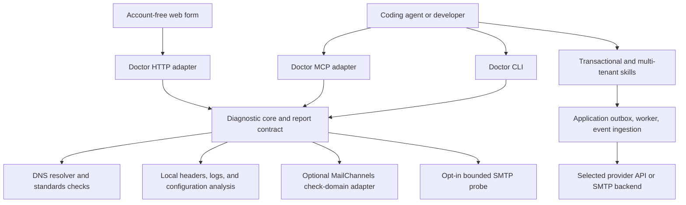

# Toolkit design

## Product contract

An agent should be able to diagnose an email problem before choosing a vendor, implement reliable application email with its preferred backend, and add customer sending without allowing one customer to compromise another. These are three independently useful entry points with shared concepts and evidence formats.

Email Doctor's core runs without an account, API key, or sending-provider subscription. The skills are ordinary versioned files, usable offline after installation. Neither skill requires Doctor, an MCP host, or a particular agent product.

## Architecture

The diagnostic core emits structured findings and never writes DNS or sends email. Transport adapters expose the same inputs and reports. The sending interface described by the skills belongs inside the application; Doctor does not become a mail relay.

## Distribution

Proposed implementation: a TypeScript package with a reusable core, CLI binary, thin MCP server, and optional self-hosted HTTP service. Use Node's resolver for local DNS and a replaceable resolver interface for hosted environments. Avoid a hosted dependency in the CLI's default path.

Keep `skills/` as the portable distribution, `schemas/` as the versioned diagnostic contract, and `examples/` as synthetic fixtures. Future runtime code should live under `packages/doctor-core`, `packages/doctor-cli`, `packages/doctor-mcp`, and `packages/doctor-http`. Do not create those packages until they have working implementations.

Version the report schema independently of package releases. A major schema change is required for removed fields or changed meanings. CLI and MCP integrations should tolerate new finding codes and optional fields.

## Shared design rules

- Findings carry observations, source, time, scope, confidence, and a concrete next step. Missing evidence produces `unknown`, not a pass or a failure.
- A valid DNS record is different from successful message authentication; SMTP acceptance is different from inbox placement.
- Provider extensions remain namespaced. MailChannels Domain Lockdown should only affect MailChannels-specific readiness, never generic readiness.
- Skills preserve the application's existing backend unless the task calls for selecting or changing it. Provider comparisons use capabilities, operating constraints, and total cost.
- Account-free diagnosis can suggest a provider when asked, but does not gate a fix behind signup or silently alter the sending service.
- Credentials stay in the application or the user's local environment. Hosted diagnostics do not collect private DKIM keys or SMTP passwords.

## Application boundary

Both skills use an application-owned message identifier, transactional outbox, durable worker, provider adapter, event inbox, and suppression store. A provider adapter normalizes submission and events but preserves raw provider codes for debugging. It declares capabilities, including idempotent submission, tenant credentials, custom return paths, webhook authentication, and suppression scope. Unsupported capabilities need explicit application handling, not fabricated success.

The multi-tenant skill adds tenant-scoped ownership, authorization, usage, queues, sender verification, and lifecycle controls around that same pipeline. It is useful for customer-branded transactional email and customer messaging products. Marketing or bulk sending additionally needs consent records, unsubscribe flows, and the relevant compliance and mailbox-provider requirements.

## Delivery plan

1. **Design and skills (this repository):** installable instructions, backend evaluation, diagnostic specification, versioned schema, and a synthetic report.
2. **Local Doctor:** implement direct DNS/authentication checks using the [local implementation guide](local-domain-check.md), JSON/text CLI, bounded local header/log analysis, and fixture-based tests. MailChannels currently requires an API key; its removal is underway separately and expected in the near future. Finalizing the account-free MailChannels adapter is pending that change's merge, deployment, and verification of its new request/response contract. Local implementation work can proceed independently.
3. **Agent access:** expose the same core over MCP; add contract tests that compare CLI and MCP output for identical fixtures.
4. **Hosted access:** release a self-hostable web form and HTTP API with public-target restrictions, request budgets, privacy controls, and rate limits. A public free service needs an identified operator and budget; an open-source license does not pay for hosting.
5. **Application examples:** add one complete transactional application and one tenant-isolation example, then expand backend adapters based on maintained integration coverage.

Do not claim an adapter is supported until submission, authentication, normalized events, suppression behavior, retry semantics, and its documented limitations have been verified. Examples should pin SDK versions and link to current vendor documentation.

## Acceptance criteria

### Email Doctor

- Clean local installation diagnoses public DNS with no credentials and no MailChannels dependency.
- Fixtures distinguish NXDOMAIN, NODATA, SERVFAIL, timeouts, duplicate SPF/DMARC records, SPF cycles and lookup limits, missing DKIM selectors, and valid/invalid alignment.
- DMARC organizational-domain discovery uses a maintained public suffix implementation, with tests for multi-label suffixes; it does not assume the final two labels form the organizational domain.
- SPF evaluation follows RFC 7208, including lookup and void-lookup limits, recursion, redirect, IPv4/IPv6, and temporary errors. Syntax checking alone never reports that a sender is authorized.
- Unknown fields, malformed upstream responses, 401/403, 429, and 5xx from MailChannels produce an adapter limitation; direct checks still complete.
- Machine reports validate against the published schema; JSON goes to stdout and operational diagnostics to stderr. No diagnostic path mutates DNS or sends a message.
- Hosted network tests reject private, loopback, link-local, metadata, and rebinding targets for both IPv4 and IPv6, including redirects and every address selected for connection.

### Skills and future reference applications

- A reset token expires and is single-use under concurrent redemption; initiating a reset does not disclose account existence.
- A worker crash after provider acceptance exercises the documented duplicate/unknown-outcome handling.
- Webhook signature failures change no state; duplicate and reordered authenticated events are harmless; complaints and permanent bounces prevent the next eligible submission.
- Tenant A cannot submit, read events, use a domain, spend quota, or edit suppressions belonging to tenant B, including when IDs appear in a payload.
- Disabling a tenant blocks its queued work and credentials; its quota exhaustion does not starve other tenants.
- Backend choice is justified by requirements. At least two viable approaches are considered when selecting a new backend; there is no mandatory default vendor.

## Maintenance

Maintain a capability matrix with source links, verification dates, and tested SDK/API versions as adapters are added. A sponsor can fund hosting or adapters without receiving preferential diagnostic verdicts. Publish release notes and security reporting instructions before public runtime releases; never commit real recipient data, tokens, or credentials as fixtures.
